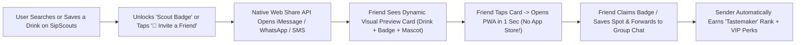

# 🚀 SipScouts Viral Growth, Engagement & Micro-Monetization Strategy

> [!IMPORTANT]
> **100% Free Infrastructure Fit:** Every viral mechanic below runs at **$0 incremental cost** on your existing stack (**Next.js 16 on Vercel** + **Supabase** + **Browser Web Share API** + **Next.js `ImageResponse` Dynamic OpenGraph cards**).

---

## 1. The Core Viral Engine: "Share Badge" + "Meet Me For A Sip" Loop

### A. Your "Share Badge" Loop (Identity & Gamification)
People share badges when they make the sender look like an **insider/tastemaker**. Using our locked-in **Aardvark Scout Mascot** and **Smoothed V-Edge Emblem**, users automatically earn shareable badges right inside the app:
- **🧭 First Sip Pioneer:** First person in a ZIP code to scout a specific drink or ingredient (e.g., *"First to scout Cardamom Latte in 07044"*).
- **🍵 Matcha & Tea Maven:** Scouted or bookmarked 3+ specialty tea/matcha spots.
- **🍸 Speakeasy Scout:** Scouted or bookmarked 3+ craft cocktail bars.
- **👑 Neighborhood Tastemaker:** Unlocked when 3 friends tap your shared link and join SipScouts.

### B. Extension #1: The "Meet Me For A Sip" 1-Tap Venue Invite (Highest Viral K-Factor)
While badges drive *ego sharing*, **inviting a friend to grab a specific drink** drives *daily utility sharing* in text threads and group chats:
- Every venue card on `/discover` gets a **`🥂 Share / Invite Friend`** button next to `🔖 Save`.
- Tapping it opens the phone's native share sheet (iMessage, WhatsApp, Instagram DM) with a **dynamic visual preview card** generated automatically by Next.js:
  - *"Justin scouted **Pistachio Matcha** at **[Café Name] (0.3 mi away · 🟢 Open Now)** — Meet me here or claim your Scout Badge!"*
- When the recipient taps the card in iMessage:
  1. It opens a dedicated fast landing view showing the exact venue, distance, and their friend's badge.
  2. Features two 1-tap actions: **🔥 Save This Spot & Claim My Scout Badge** and **↗ Forward to Group Chat**.

### C. Extension #2: "Your Sip DNA" Card (The "Spotify Wrapped" Effect on `/profile`)
When a user saves their **Favorite Drinks & Favorite Ingredients** on `/profile`, SipScouts automatically generates a visual **"Sip DNA / Taste Persona Card"** they can text or post to Instagram Stories:
- *Example:* **"Justin's Sip DNA: 45% Artisanal Espresso · 35% Agave & Mezcal · 20% Ceremonial Matcha — Scout Rank: Founding Explorer."**
- Includes a button at the bottom of the shared link: **"What's Your Sip DNA? Take the 15-Second Craving Test →"**

---

## 2. Cross-Platform Growth Loops (Driving Free Traffic from Other Platforms)

| Platform | The Growth Mechanism | Why It Works for $0 |
| :--- | :--- | :--- |
| **1. Instagram & TikTok ("Venue Tagging Loop")** | Add a **`📸 Story Card`** button that exports a vertical image showing the drink, venue name, and the venue's **actual `@instagram` handle** (which our scraper already fetches!) + `@SipScouts`. | When a user posts *"Found the best Yuzu Spritz!"* and tags the bar's `@instagram`, **local cafés and bars repost customer stories to their 5,000–30,000 local followers** — giving SipScouts free local billboard advertising! |
| **2. Google Search (Programmatic Local SEO Pages)** | Automatically turn popular searches into public, Google-indexable pages (`/craving/pistachio-latte/austin-tx` or `/craving/espresso-martini/brooklyn-ny`). | Thousands of people Google *"where to find [drink/ingredient] in [city]"* every day. Dynamic Next.js pages let Google send free, high-intent searchers straight into SipScouts. |
| **3. Physical Café/Bar Counter Stickers ("Scout Approved 🏆")** | Send top-ranked local cafés a free printable QR card/window decal: *"Voted a Top Local Gem on SipScouts — Scan to see what drinks we're famous for!"* | Captures high-intent coffee and cocktail lovers while they are literally standing in line waiting for their drink. |
| **4. Reddit & Local Foodie Communities** | Share direct deep-links (`sipscouts.com/discover?drink=Hojicha&zip=11211`) in city subreddits (`r/FoodNYC`, `r/AustinFood`, `r/Matcha`, `r/cocktails`) whenever someone asks *"Where can I find [X]?"* | Gives an immediate, zero-paywall map answer to the exact question they asked, turning Reddit threads into permanent referral links. |

---

## 3. Micro-Monetization That *Accelerates* (Never Slows Down) User Growth

> [!TIP]
> **The "Pay \$1.99 OR Invite 3 Friends" Growth Lever:**
> Never put a paywall on searching, saving spots, or sharing badges. Instead, offer a fun **"VIP Scout Pass"** where users can **either pay a tiny micro-price (\$1.99) OR unlock it 100% FREE by referring 3 friends!**
> - **80% of users** will refer 3 friends to get it free (exploding your viral K-factor!).
> - **20% of users** will gladly tap Apple Pay / Google Pay for \$1.99 (creating high-margin consumer micro-revenue that adds up fast across thousands of users).

### Consumer Micro-Revenue Streams (B2C — \$0.99 to \$2.99)
1. **SipScouts "Gold Scout / VIP Pass" (\$1.99/mo or \$9.99/yr — *or FREE with 3 friend referrals!*):**
   - Unlocks **Unlimited Favorite Drink & Ingredient Radar Alerts** (free tier includes 5 drinks + 5 ingredients).
   - Unlocks **"Secret Menu & Insider Notes"** on venues (what regulars order off-menu).
   - Unlocks **Exclusive Holographic / Gold Aardvark Scout Badges** on shared cards.
2. **"Gift a Sip / Digital Coffee & Cocktail Roulette" (\$0.99 – \$1.99 micro-feature or Tip Jar):**
   - Let users send a customized **"IOU 1 Drink at [Venue Name]"** voucher badge card to a friend's birthday or date night via iMessage!

### Local Business & Brand Micro-Revenue Streams (B2B — \$29 to \$249)
1. **Sponsored Neighborhood Badges (\$49 – \$99 per campaign):**
   - A local café or bar sponsors a local badge (e.g., *"The Downtown Espresso Martini Trail — Sponsored by [Bar Name]"*). Every user who shares or claims the badge sees the sponsor and gets a small perk (e.g., \$2 off or priority seating).
2. **"Promoted Craving Pin" on Search Results (\$29/mo self-serve for small cafés):**
   - Super-low entry price so any independent coffee shop can highlight their signature seasonal drink at the top of local search results with a **`✨ Featured Local Gem`** badge.
3. **Custom Neighborhood Craving & Supply-Gap Reports (\$99 one-off / \$49–\$79/mo subscription):**
   - Powered directly by your Supabase `search_events`, `unmet_demand_analytics`, and `venue_clicks` tables.

---

## 4. Recommended Implementation Order (Can Be Built Right Now for \$0)

1. **Step 1 (Build Today):** Add the **3 Supabase B2B Analytics Upgrades** (`venue_clicks` for Call/Instagram/Menu clicks + `unmet_demand_analytics` SQL view + `user_id` search attribution) so every viral click is tracked from Day 1.
2. **Step 2 (Build Today):** Build the **Viral "Share Badge & Invite a Friend" Engine**:
   - Dynamic OpenGraph Preview Image generator (`/api/og/badge`) featuring your **Smoothed V-Edge Logo** + **Aardvark Mascot** + user/drink details.
   - **`🥂 Share / Invite`** button on every venue card in `/discover` using the native mobile **Web Share API** (`navigator.share`).
   - Shareable **Scout Badges & Sip DNA Card** on `/profile` with automatic referral tracking (`?ref=...`) in Supabase!
